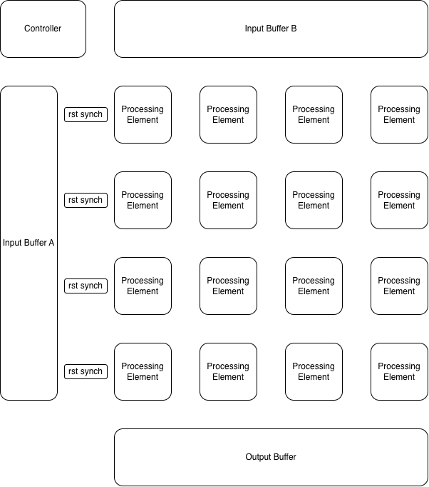
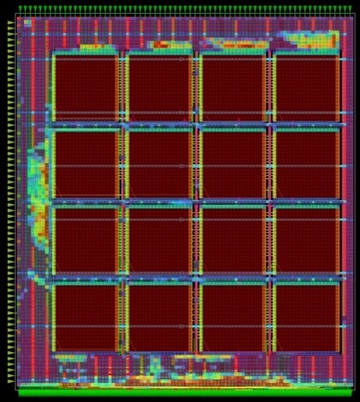

# Pipelined 4x4 BF16 Systolic Array

A 4x4 output-stationary systolic array that multiplies BF16 matrices. Each PE does an exact BF16 x BF16 multiply and accumulates in FP32, and the results come out as BF16. This version was taken from RTL to GDSII on SkyWater 130nm using LibreLane, with the processing element hardened as a macro and placed 16 times.

## ASIC Notes

- Timing closed at 40 ns (25 MHz) across all 9 PVT corners, with clean DRC (Magic and KLayout) and LVS.
- Hierarchical flow: the PE is hardened on its own, then integrated into the top level as 16 hard macros on a 4x4 grid. Die is 970 x 1080 um.
- The critical path is the PE's internal accumulate loop (accumulator -> `fp32_add` -> accumulator). Top-level paths between PEs have much more slack, so the PE sets the chip's clock.
- Gate-level simulation of the final netlist passes the same vectors as RTL simulation, bit-exact.
- Still open: max slew and max cap cleanup at the top level.
- Worst setuyp slack: 18.27 ns (top level), 4.0975 ns (Processing Element)

### How it got there

| Step | Change | Result |
| --- | --- | --- |
| Flat baseline | Whole design flat, 40 ns | Failed setup by 4.96 ns at the slow corner; 63-gate multiply-add chain |
| Clock sweep | 50 ns, 60 ns | Didn't help: the resizer did less work at looser clocks |
| Pipelining | Register between `bf16_mul` and `fp32_add` | Critical path moved to the accumulate loop |
| Delay cells | Excluded `clkdlybuf4s*` from the resizer | Removed about 21 ns of delay-cell padding from the critical path; closed at 45 ns |
| Reset | Two-flop reset synchronizer per row | Clean reset release timing (recovery/removal) |
| Floorplan | Utilization sweep and a pin plan matched to the dataflow | Smaller die, fewer slew violations |
| Hierarchy | PE hardened as a macro, 16 instances, grid-snapped placement | DRC/LVS clean; closes at 40 ns |

## Architecture

- **Dataflow:** output-stationary. A streams left to right, B streams top to bottom, and each PE keeps its own C[r][c]. When the computation finishes, the results shift down the columns and come out of the bottom row.
- **PE:** `bf16_mul` gives the exact product in FP32 (an 8x8-bit mantissa product always fits). A pipeline register (`mul_add_register`) holds the product, then `fp32_add` adds it to the accumulator. Multiplies with an exact-zero operand are skipped. The A and B forwarding registers live inside the PE (`a_out`, `b_out`), so every PE-to-PE wire is flop to flop.
- **Controller:** IDLE -> LOAD (2N-1 cycles) -> COMPUTE (N+1, one extra cycle for the pipeline) -> DRAIN (N) -> IDLE.
- **mem_interface:** skew buffers on the inputs and the result latch on the output.
- **Reset:** the raw `rst` pin feeds one two-flop synchronizer per array row plus one for the controller and `mem_interface`. Reset asserts asynchronously and releases on a clock edge.

### Floorplan plan

First-draft floorplan, drawn before layout: controller in the top-left corner, A skew registers down the left edge, B skew registers along the top, result registers along the bottom, and the 4x4 PE grid in the middle. Pins sit on the edge where their data enters or leaves.



### Layout

The top-level layout with the PE macros. At the top level, each PE is a black box (its LEF outline and pins), so the 16 PE sites show up as empty holes in the grid. The routing channels between them carry the PE-to-PE wiring and the top-level power straps.



## Numeric behavior

| Step | Behavior |
| --- | --- |
| Inputs | BF16, subnormals treated as zero |
| Multiply | exact, result in FP32 |
| Accumulate | FP32, k = 0 to N-1, round toward zero, flush to zero, overflow to Inf |
| Output | FP32 to BF16 by truncation |
| Inf / NaN | IEEE propagation. Inf x 0 is skipped like any zero product (no NaN) |

`model/golden_bitexact.py` implements exactly this, so the testbench compares at zero tolerance.

## Repo layout

```
rtl/       design (rtl/pipelined is the current version)
tb/        tb_mini_tpu.sv (top level), tb_units.sv (multiplier and adder)
model/     bit-exact golden model and vector generators
vectors/   test vectors
scripts/   regression and synthesis scripts, file list
asic/      LibreLane flow: top-level config, pin plan, saved metrics
asic/pe/   PE macro: config, pin plan, hardened views
images/    floorplan and layout images
```

## Running

From the repo root:

```
./scripts/run_verilator.sh      # or ./scripts/run_icarus.sh
vsim -c -do scripts/run_modelsim.do
./scripts/synth_yosys.sh        # gate count and logic depth
```

You should get 9 PASS lines: the unit test, the 10 original vectors, and 6 sets of 1,000 random matrices (uniform, wide range, sparse, cancellation, underflow, overflow).

The testbench takes `+FILE=<vectors>`, `+TOL=<ulps>` (default 0) and `+MAXERR=<n>`. It flags X outputs and times out if `result_valid` never comes.

To make new vectors:

```
python3 model/gen_vectors.py wide 1000 [seed]
python3 model/gen_unit_vectors.py
```

### ASIC flow

Needs LibreLane (Nix install) and sv2v.

```
asic/pe/build_pe.sh <tag>        # harden the PE macro
asic/build_chip.sh <tag>         # top level with the PE macros
asic/test_netlist.sh <tag> [vec] # gate-level sim of the final netlist
asic/save.sh <tag>               # copy metrics and reports into asic/metrics/<tag>/
```

## Status

- Bit-exact at zero tolerance on all vectors in Verilator 5.020 and Icarus 12.
- Taken to GDSII on SkyWater 130nm: closes at 40 ns across all PVT corners, DRC and LVS clean.
- Not done yet: max slew and max cap cleanup, directed reset/protocol tests, N other than 4, functional coverage.